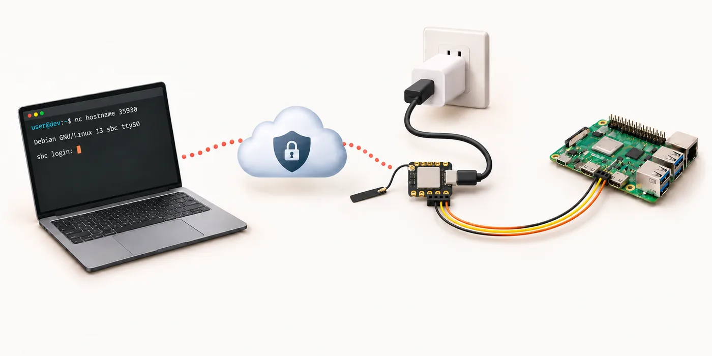

# serial-over-tailnet

[English](README.md)

PSRAM 付きの ESP32-S3 単体で Tailscale のネットワーク（Tailnet）に参加し、対象 SBC のシリアルコンソールを Tailnet 上の TCP ポートに中継するアダプタである。
中継するのは、対象の 3.3 V の UART（Seeed Studio XIAO ESP32S3 か ESP32C3 を使う場合）か、対象の USB シリアルインターフェース（YD-ESP32-S3 を使う場合）である。
2026 年 11 月までは usb-serial-over-tailscale という名前だった。



```text
Remote PC ──Tailscale / TCP:35930────▶ XIAO ESP32S3/C3 ──UART───▶ 対象 SBC の UART コンソール
Remote PC ──Tailscale / TCP:35930+n──▶ YD-ESP32-S3 ───USB host──▶ 対象 SBC のシリアルインターフェース n
```

Tailscale のノードとして必要な機能（制御プロトコル、WireGuard、DERP、NAT 越え）は Rust で独自に実装している。
初期設定は USB シリアル上の対話シェルで行い、書き込みと設定はブラウザだけで完了する。

## 対応状況

動作するものは次のとおりである。

- ウィザードによる Wi-Fi 設定と、承認 URL 方式での Tailnet 参加。
- 別ノードからの `tailscale ping`（DERP 経由と直接経路）。
- XIAO ESP32S3 での、Raspberry Pi 5 の 3.3 V の UART（3 ピンのデバッグ用コネクタ）のコンソール操作。
- XIAO ESP32C3（PSRAM なし）での、ピア 50 台の Tailnet への参加、DERP 接続、ブリッジへの 300 回続けての接続（メモリは横ばい）、Tailnet 経由での UART の折り返し（D10 と D8 を直結）。
- YD-ESP32-S3 での、USB 経由の Raspberry Pi Debug Probe（CDC-ACM）と Toradex Dahlia（FT4232H）のコンソール操作。
- USB の対象 2 つに対する RFC 2217 セッション。pyserial からのボーレートとフレーミングの変更、DTR と RTS、ブレーク、purge。
- FT4232H で 3 ポートを同時に claim し、4 つ目のポートのクライアントが拒否されること。
- アダプタ再起動、Wi-Fi 再接続、USB 抜き差しからの復帰。

まだのものは次のとおりである。

- auth key による headless 登録。
- XIAO の UART での RFC 2217 セッション（実装済み、クライアントでは未確認）。
- XIAO ESP32C3 の UART を対象につないだ動作（確かめたのは折り返しだけ）。
- CP210x、CH340/CH341、FT232R など H シリーズ以外の FTDI。
- 対象 SBC 自体の再起動、インターネット断、control サーバ到達不能からの復帰。
- 長時間運用、鍵期限切れ（既定 180 日）後の挙動、Task WDT による再起動。
- RFC 2217 経由の esptool（DTR と RTS の操作列は `cargo run -p adapter-core --example rfc2217_sim` でホストでテスト済み）。

### ボードとイメージ

flash の容量と PSRAM の方式はビルド時の固定設定なので、CI はボードとモジュールごとにイメージを作る（`firmware/variants/`）。
ESP32-S3 のボードでは PSRAM は必須である。
ネットワーク系スレッドのスタック、TLS のバッファ、ヒープの大半を PSRAM に置いている。
ESP32-C3 には PSRAM がない。
そのイメージはスタックとバッファを小さくしてビルドし（tsnode の feature `small-ram`）、ピア 50 台の Tailnet で RAM が 40 KB ほど空いている。

| イメージ | ボード | flash | PSRAM | 状況 |
| --- | --- | --- | --- | --- |
| `xiao-s3` | Seeed Studio XIAO ESP32S3 | 8 MB | 8 MB Octal | 対応 |
| `xiao-c3` | Seeed Studio XIAO ESP32C3 | 4 MB | なし | 対応（UART は折り返しで確認） |
| `n16r8` | YD-ESP32-S3（モジュール N16R8） | 16 MB | 8 MB Octal | 対応 |
| `n8r2` | YD-ESP32-S3（モジュール N8R2） | 8 MB | 2 MB Quad | 対応 |
| `n8r8` | YD-ESP32-S3（モジュール N8R8） | 8 MB | 8 MB Octal | ビルドのみ |
| | PSRAM のないモジュール（N4、N8、N16） | | なし | 非対応 |

手元でイメージをビルドするには、esp-idf-sys にそのイメージの defaults ファイルを渡し、イメージ作成スクリプトにも名前を渡す。
XIAO のイメージには feature の指定も要る。
ESP32-C3 は別のターゲットで、USB ホストのコンポーネントを外してビルドする。

```bash
cd firmware
ESP_IDF_SDKCONFIG_DEFAULTS="sdkconfig.defaults;variants/xiao-s3.defaults" cargo build --release --features board-xiao-s3
tools/mkimage.sh xiao-s3 release

MCU=esp32c3 ESP_IDF_SYS_EXTRA_COMPONENTS_FILE="$PWD/variants/no-extra-components.toml" \
ESP_IDF_SDKCONFIG_DEFAULTS="sdkconfig.defaults;variants/xiao-c3.defaults" \
  cargo build --release --features board-xiao-c3 --target riscv32imc-esp-espidf
tools/mkimage.sh xiao-c3 release

ESP_IDF_SDKCONFIG_DEFAULTS="sdkconfig.defaults;variants/n8r2.defaults" cargo build --release
tools/mkimage.sh n8r2 release
```

## 構成

| パス | 役割 |
| --- | --- |
| `crates/tsnode` | Tailscale ノード実装。制御プレーン（ts2021 Noise と最小の HTTP/2）、WireGuard、DERP、disco、STUN、smoltcp による TCP 終端。ホストでも ESP-IDF でも動く。 |
| `crates/adapter-core` | 対話式セットアップシェル。入出力とデバイス操作を trait で抽象化し、ウィザードをホストで単体テストする。 |
| `tools/hostnode` | tsnode を Linux で動かす検証ツール。実 Tailnet に参加して echo サーバを公開する。 |
| `firmware` | ESP32-S3 と ESP32-C3 のファームウェア（esp-idf-svc）。設定コンソール、UART の中継（XIAO ESP32S3 と ESP32C3）、USB ホスト（YD-ESP32-S3。CDC-ACM、FTDI、CP210x、CH34x）、Wi-Fi、Tailscale ノード、TCP ブリッジ。 |
| `hardware/case` | YD-ESP32-S3 用の 3D プリントケース。OpenSCAD のソースと、そのまま印刷できる STL（ピンヘッダの有無の 2 種類）がある（[README](hardware/case/README-ja.md)）。 |
| `hardware/xiao-carrier` | XIAO ESP32S3 用のキャリア基板。レベル変換と 4 ピンのヘッダを持つ。設計済みで未製作（[README](hardware/xiao-carrier/README-ja.md)）。 |
| `hardware/board` | ESP32-S3-MINI-1 を使う独自のアダプタ基板。発注済みで未検証（[README](hardware/board/README-ja.md)）。 |

tsnode の内部は次のモジュールに分かれる。

| モジュール | 内容 |
| --- | --- |
| `controlbase`、`h2`、`control` | `/key` の取得、`POST /ts2021` による Noise IK ハンドシェイク、HTTP/2 での `/machine/register` と `/machine/map`。`/key` は常に TLS、Noise 経路は :80 の平文を試してから TLS に切り替える。 |
| `wireguard` | Noise IKpsk2 ハンドシェイク（initiator と responder）、transport、replay window、rekey と keepalive のタイマ。 |
| `derp` | DERP リレークライアント（TLS、fast-start、ping と pong、NotePreferred）。 |
| `disco`、`stun` | 直接経路のための ping、pong、call-me-maybe と、STUN による公開エンドポイントの検出。 |
| `magicsock` | UDP 直接経路と DERP 経路の選択、ハンドシェイクの処理、ピア表の管理。 |
| `netstack` | smoltcp による Tailnet アドレス上の TCP 終端。 |
| `node` | 上記をスレッドで束ねる。鍵は NVS またはファイルに永続化する。 |

## 使い方

### ボードを準備する

使えるボードは 2 つあり、対象のコンソールが何に出ているかで選ぶ。

| ボード | 中継するもの | はんだ付け |
| --- | --- | --- |
| Seeed Studio XIAO ESP32S3 | 対象の 3.3 V の UART（ピンやデバッグ用コネクタ） | ピンヘッダ付きのボードなら要らない |
| Seeed Studio XIAO ESP32C3 | 同上（ピンが違う） | 同上 |
| YD-ESP32-S3 | 対象の USB シリアル（デバッグ用 USB ポート） | 要る（裏面の `USB-OTG` パッド） |

#### Seeed Studio XIAO ESP32S3

[Seeed Studio XIAO ESP32S3](https://www.seeedstudio.com/XIAO-ESP32S3-p-5627.html) を買う。
日本では[秋月電子通商](https://akizukidenshi.com/catalog/g/g118078/)などで買える。
USB-C は 1 つで、USB ホストとしては使わない。
USB シリアル変換器の代わりに **3.3 V の UART** を中継し、ポートは 35930 である。
対象の UART がピンやデバッグ用コネクタに出ている場合に使う。
Raspberry Pi 5 の 3 ピンのデバッグ用コネクタがその例である。

| XIAO のピン | 役割 | つなぐ先 |
| --- | --- | --- |
| `GND` | グラウンド | 対象の GND |
| `3V3` | 使わない | 何もつながない |
| `D10` | TX（XIAO の出力） | 対象の RX |
| `D9` | RX（XIAO の入力） | 対象の TX |

この 4 本はボードの片側に並んでいる（USB-C の端から 5V、GND、3V3、D10、D9、D8、D7）。
ピンヘッダ付きのボードなら、ジャンパ線をそのまま挿せる。
ピンヘッダのないボードには、4 ピンのソケットかピンヘッダをはんだ付けする。
UART は 3.3 V 専用である。
5 V や RS-232 の信号にはつながず、1.8 V の対象には間にレベル変換を入れる。
ボードに付属のアンテナを取り付ける。

インストーラのページでは、「使うボードを選ぶ」の最初の項目である。
シリアルポートが現れないときは、`B`（BOOT）ボタンを押しながらボードを挿す。
USB ポートは設定後も設定用のコンソールのままである（ポートが 1 つしかない）。
給電もこのポートから行い、充電器でも対象の USB ポートでもよい。
ボーレートは `baud` で決めるか（初期値は 115200）、RFC 2217 のクライアントが設定する。
DTR と RTS の線はない。

動作を確認したのは無印の XIAO ESP32S3 と Raspberry Pi 5 の組み合わせである。
Sense と Plus は試していない。
このボードでは、ファームウェアが Wi-Fi の送信出力を 15 dBm に制限する。
19.5 dBm 以上では 2 台のアクセスポイントとのアソシエーションを越えられず、18 dBm 以下では越えられた。
日本では技適付きで売られている。
工事設計認証番号は 217-230892 である（[秋月電子通商の商品ページ](https://akizukidenshi.com/catalog/g/g118078/)の記載）。
ほかの国では、ボードの表示とその国の規則を確かめてほしい。
[`hardware/xiao-carrier/`](hardware/xiao-carrier/) は、このボード用の小さなキャリア基板である（未製作）。

#### Seeed Studio XIAO ESP32C3

[XIAO ESP32C3](https://wiki.seeedstudio.com/XIAO_ESP32C3_Getting_Started/) は外形が同じで、使い方も同じである。
違いは次のとおりである。

| XIAO のピン | 役割 | つなぐ先 |
| --- | --- | --- |
| `GND` | グラウンド | 対象の GND |
| `D10` | TX（XIAO の出力） | 対象の RX |
| `D9` | 使わない | 何もつながない |
| `D8` | RX（XIAO の入力） | 対象の TX |

ピンは S3 と同じ側にある（USB-C の端から順に 5V、GND、3V3、D10、D9、D8、D7）。
GND から D8 までの 5 ピンのソケットで全部に届く。
RX が D9 ではなく D8 なのは、C3 の D9 が GPIO9 だからである。
GPIO9 は BOOT ボタンが GND に落とすピンで、リセット時に Low だと書き込みモードで起動する。
キャリア基板は D9 につないでいるので、C3 には使えない。

ESP32-C3 には PSRAM がないので、ファームウェアは持つ情報を減らしている。
ピアごとの接続先候補は数個だけにし、ピアの WireGuard の状態はそのピアと通信が始まってから作り、Tailnet 上の TCP の窓は 2 KB にしている。
ピア 50 台の Tailnet に、RAM を 40 KB ほど残して参加できた。
はるかに大きな Tailnet では入らないかもしれない。
UART は折り返しで確かめたが、対象につないだ動作はまだ確かめていない。
日本では技適付きで売られている。
工事設計認証番号は 204-B00704 である（[秋月電子通商の商品ページ](https://akizukidenshi.com/catalog/g/g117454/)の記載）。

#### YD-ESP32-S3


[VCC-GND Studio の **YD-ESP32-S3**（AliExpress の商品ページ）](https://ja.aliexpress.com/item/1005004025123046.html)を買う。
商品ページの選択肢から **N16R8** か **N8R2** を選ぶ。
この 2 つに対応している。
ボードには USB-C が 2 つあり、`COM` と `USB` と書いてある（[メーカーの写真と資料](https://github.com/vcc-gnd/YD-ESP32-S3)）。

**無線の認証についてのお知らせ。**
YD-ESP32-S3 は安くてよいボードである。
買う前に知っておいてほしいことが 1 つある。
このボードの Wi-Fi モジュール（刻印 `ESP32-S3-N16R8`、`ESP32-S3-N8R2`）は Espressif の認証済みモジュールではなく、技適を取得していない（総務省のデータベースで調べた）。
ほかの国の無線認証も見つかっていない。
これが問題になるかどうかは国によって違う。
多くの国では義務を負うのは販売者で、個人の利用者ではないので、自分の国の規則を確かめてほしい。
日本では、電波法が使う人の無線設備に技適マークを求めているため、このボードは使えない。
日本向けには、認証済みの ESP32-S3-MINI-1 モジュールを使う基板を作っている（[`hardware/board/`](hardware/board/)、2026 年 11 月に設計して発注済み、未検証）。

裏面の `USB-OTG` パッドをはんだで短絡する（下の写真は短絡前）。


これは必須で、ボードから対象の USB ポートへ 5 V を送るためのものである。短絡しないと対象のチップに電源が入らず、検出されない。
2 つのポートの役割は固定である。**`COM` = 5 V の給電**（充電器か PC）、**`USB` = SBC**（対象のデバッグ用 USB ポート）。書き込みと設定は `COM` を PC につないで行う（給電も兼ねる）。`USB` は SBC につないだままでよい。
短絡に伴う注意は後述の「給電と配線」にある。

### ブラウザから書き込む

Chrome か Edge で [signal-slot.github.io/serial-over-tailnet](https://signal-slot.github.io/serial-over-tailnet/) を開くと、ソフトウェアを何も入れずに書き込みと初期設定ができる。
ページは WebSerial でボードのシリアルポートを開き、ESP Web Tools（esptool-js）で CI がビルドしたバイナリを書く。
同じページの端末でセットアップウィザードも操作できる。
Windows 10 以降、macOS、Linux、ChromeOS で動き、Firefox と Safari とスマートフォンでは動かない。

ページの最初でボードを選ぶ。

- **XIAO ESP32S3**: USB-C を PC につなぐ。`USB JTAG/serial debug unit`（303a:1001）として見える。ポートが現れないときは、いったん抜き、`B`（BOOT）ボタンを押しながら挿し直す。
- **YD-ESP32-S3**: モジュールの金属カバーの刻印（`ESP32-S3-N16R8` など）から型番を選び、`COM` 側（CH343、1a86:55d3）をつなぐ。自動ダウンロード回路で書き込め、起動ログも見え、対象は native 側につないだままでよい。native 側（303a:1001）でも書き込めて、端末を開くとすぐウィザードが始まるが、セットアップが終わるとポートは USB ホストになって見えなくなる。OS に COM ポートが見えないときは native 側を使う。

CI（GitHub Actions）は push のたびに全イメージをビルドし、`v*` タグでは Release にも `serial-over-tailnet-<イメージ>.bin`（bootloader、パーティション表、アプリを結合した 1 本）を添付する。
結合したものは `esptool write_flash 0x0` で書けるが、NVS の領域も 0xFF で上書きするので設定と登録が消える。
ページからの更新は 3 つの領域だけを書くので設定は残る。

### 初期設定

未設定のボードを PC に挿すと、USB シリアル（Espressif USB JTAG/serial、303a:1001）として見える。
XIAO では唯一のポート、YD-ESP32-S3 では native 側のポートである。
ターミナルで開いて Enter を押すと、ウィザードが始まる。
XIAO では、このポートは設定後もシェルのままで、コマンドを打つまで無言である。
YD-ESP32-S3 では、COM 側にも同じシェルが 115200 でログと一緒に出ている。
Enter を押すまで無言で、`setup` と打つとウィザードが始まる。

```bash
screen /dev/ttyACM0 115200
```

DTR と RTS は、端末が開いたときの状態、つまり両方アサートのままにすること。
これらのポートでは、2 本がチップのリセットと起動モードの選択に使われる。
別々に動かすとボードがリセットされ、ROM のダウンロードモードに入ることもある。
そうなると無言のまま何も返さなくなる。

```text
serial-over-tailnet 0.1.0 - setup mode
Press Enter to start setup, or type a command:
=== Setup ===
Scanning Wi-Fi...
   1) home-wifi        (-48 dBm)
Select network number, or type an SSID (Enter to rescan, q to quit): 1
Password for home-wifi: ********
Connected (192.168.1.42)
Hostname on the tailnet [target-console]:
Registering with Tailscale... (press q to stop waiting)
Open this URL in a browser to approve the device:
  https://login.tailscale.com/a/xxxxxxxx
Waiting for approval...
Tailscale is up: target-console.example.ts.net 100.x.y.z
Setup complete. Reboot into normal mode now? [Y/n]
```

`setup` は hostname と Tailscale の登録が済んでいれば Wi-Fi の追加だけで終わる。
すべてやり直すには `setup all` を使う。
auth key を使う場合は `authkey tskey-auth-...` を打ってから `login` する。

主なコマンドは次のとおりである。
一覧は `help` で出る。

| コマンド | 内容 |
| --- | --- |
| `wifi <ssid> <pw>` | Wi-Fi を追加して接続する。複数登録でき、起動時と再接続時に一番強い既知の AP を選ぶ。 |
| `wifi list`、`wifi forget <ssid>` | 登録済み Wi-Fi の一覧と削除。 |
| `port <n>`、`baud <rate>` | TCP ポート（既定 35930。YD-ESP32-S3 では対象の USB インターフェース n が port+n に出る）と対象のボーレート（既定 115200）。 |
| `usbdrv <auto\|cdc\|ftdi\|cp210x\|ch34x>` | YD-ESP32-S3 のみ。USB シリアル変換チップの指定。既定は VID と PID による自動判別。 |
| `status`、`reset`、`reboot` | 状態表示、設定と鍵の消去、再起動。 |

XIAO では、シェルは常に USB ポートにある。
そのため `setup` を含むどのコマンドも、いつでも実行できる。
ログは UART0（ピン D6 が TX、D7 が RX、115200 bps）に出る。
YD-ESP32-S3 では、同じシェルが COM ポート（115200 bps、ログと共用）で常時使える。
Enter を押すとプロンプトが出る。
ファームウェアの起動時に BOOT を押していると、再びセットアップモードになる。

### 接続

XIAO ESP32S3 は、UART を 1 つの TCP ポートに出す。
`port` で変えなければ 35930 である。

YD-ESP32-S3 では、対象のシリアルインターフェースが 1 本ずつ別の TCP ポートに出る。
ポート番号は先頭のポートに USB インターフェース番号を足したものである。
どのインターフェースがシリアルかは機器を挿したときに記述子から読むので、設定は要らない。

| 対象 | インターフェース | ポート |
| --- | --- | --- |
| 普通の CDC-ACM コンソール（1 機能） | 0 | 35930 |
| Raspberry Pi Debug Probe（0 は CMSIS-DAP） | 1 | 35931 |
| Toradex Dahlia の MCU コンソール（FT4232H ポート C） | 2 | 35932 |
| Toradex Dahlia の Verdin コンソール（FT4232H ポート D） | 3 | 35933 |

Tailnet 上の任意の端末から、hostname か Tailnet アドレスのそのポートに、生の TCP か RFC 2217（Telnet）でつなぐ。

```bash
socat -,rawer,escape=0x1d TCP:target-console:35930   # Ctrl-] で抜ける
nc target-console 35930
python -m serial.tools.miniterm rfc2217://target-console:35930 9600   # RFC 2217: クライアントが回線を設定する
esptool --port rfc2217://target-console:35930 flash_id                 # YD-ESP32-S3: DTR と RTS で ESP32 の対象をリセットする
```

1 つのポートで同時に使えるのは 1 接続である。
使用中に届いた 2 本目の接続には `busy` と応答して切断する。
応答のない相手は 120 秒で切り、次の接続を受け付ける。

セッションの種類は、クライアントが最初に送る 1 バイトで決まる。
pyserial の `rfc2217://` や esptool のように Telnet のネゴシエーション（IAC、0xFF）で始めるクライアントは RFC 2217 セッションになる。ボーレート、データ長、パリティ、ストップビットの設定、DTR と RTS の操作、ブレーク、受信バッファの破棄ができ、どの設定にも実際に効いた値で応答するので、断られた設定はクライアントに分かる。
設定はそのクライアントが切るまで有効で、次のセッションはアダプタの `baud` と 8N1、DTR と RTS を ON にした状態から始まる。
フロー制御は常に「なし」と応答し、モデム状態と回線状態の通知は送らない。
それ以外は生のセッションで、バイト列はそのまま双方向に流れ、プロトコルの付加はなく、ボーレートはアダプタ側の設定で決まる。
`telnet` は、先に交渉を送る実装（netkit、inetutils）なら文字モードの RFC 2217 セッションになり、サーバーが先に話すのを待つ BSD 版は行モードの生セッションになる。
クライアントの最初の 1 バイトが届く前に対象から来たバイトは、どちらの場合もそのまま送る。
XIAO の UART には DTR と RTS の線がない（要求は受け付けるが何もしない）。
ブレークは TX を Low に保って作り、マークパリティとスペースパリティは断る。

YD-ESP32-S3 では、ポートどうしは独立していて、USB インターフェースも busy 判定も回線の設定も別々で、あるポートの接続が別のポートを妨げることはない。
共通なのは USB 機器と Tailnet アドレスである。
USB インターフェースは最初のクライアントが接続したときに claim し、クライアントが切れても保持する。誰もつないでいない間のターゲットの出力は捨てる。
ESP32-S3 のホストコントローラのパイプは 8 本で、制御に 1 本、claim したインターフェース 1 つにつき 2 本（CDC-ACM は 3 本）使うので、FT4232H で claim できるのは 3 ポートまでである。claim は USB を抜くかアダプタを再起動するまで続く。4 本目のポートに来たクライアントには `usb: cannot open the interface: no free USB host pipe` と伝えて切断する。
`status` はインターフェースとポートの一覧に、開いているものは回線設定を、claim 済みで空いているものは `claimed` を添える。

### 給電と配線

**XIAO ESP32S3。**
給電は USB-C から行う。
充電器でも、PC でも、対象の USB ポートでもよい。
対象から給電すると、対象の USB の電源が切れたときに XIAO も止まり、電源が入ってから Tailnet に参加するまで数十秒かかる。
充電器から給電すれば、対象が再起動する間もつながったままである。
対象とは「ボードを準備する」の表のとおり 3 本の線でつなぎ、XIAO の `3V3` ピンには何もつながない。

**YD-ESP32-S3。**
給電は COM 側の USB から行う。
PC でも USB 充電器でも構わない。
native 側は USB ホストとして対象につなぐポートで、対象のデバッグポートから電源は来ない前提である。

native 側から 5 V を出すには、裏面の `USB-OTG` パッドを短絡する。
このパッドは、ボードの 5 V と native 側の間にあるダイオードを迂回する。
短絡すると、COM 側の 5 V がダイオード 1 つ分だけ下がって native 側へ出る。
短絡後は**両方を同時に PC へ挿さない**。COM 側の 5 V が native 側の PC へ流れ込む。
書き込みとセットアップは COM 側を PC につなぐ。代わりに native 側を使うなら、そちらだけを PC につなぐ。
通常運用は COM 側を電源に、native 側を対象につなぐ。
対象が CDC-ACM か FTDI などのブリッジチップであれば、そのチップは通常バスパワーで動くので、この 5 V が必要である。

### 数秒ごとにリセットするボード

ボードが再起動を繰り返すとき（YD-ESP32-S3 では、COM 側のログに `rst:0x3 (RTC_SW_SYS_RST)` 付きの `ESP-ROM` バナーが 1〜4 秒ごとに出る）は、`status` の `Reset:` か、次の起動のログの冒頭にある `last reset:` 行を見る。
`brownout` は、Wi-Fi の送信中か対象のブリッジチップの起動中に電源電圧が下がったことを示す。
直すのは電源である。ボードと対象のブリッジチップを同時に賄えるポートか充電器に、短いケーブルでつなぐ。
IDF 自身の "Brownout detector was triggered" 行はログに残らないことがあり、ROM のバナーは `reboot` の後と同じに見える。
古いファームウェアが毎回出していた `Password length is zero` の警告は仮の設定から出ていたもので、保存したパスワードが空であることを意味しない。各ネットワークにパスワードがあるかは `wifi list` で分かる。
あるボードで行った手順は `RECOVERY.md` にある。

## ビルドと書き込み

前提は、`espup` で導入した `esp` ツールチェーン、`ldproxy`、`espflash` である。
ESP-IDF v5.5.5 とコンポーネント `espressif/usb_host_cdc_acm` は、初回ビルド時に `firmware/.embuild/` へ自動で取得される（数 GB、数分）。

```bash
# ホスト側の単体テストと検証ツール
cargo test
cargo run -p hostnode -- probe-control                      # 制御プレーンの疎通（鍵なし登録で AuthURL が返れば良い）
cargo run -p hostnode -- run --hostname tsnode-test        # 実 Tailnet に参加して echo サーバを公開（承認 URL を表示）

# ファームウェア（n16r8 のイメージ。ほかは「ボードとイメージ」を参照）
cd firmware
cargo build --release
```

`~/export-esp.sh` は source しない。
gcc と clang は esp-idf-sys が `.embuild/` に導入したものを使い、espup の xtensa gcc が PATH の先頭にあるとリンクに失敗する。

パーティション表は `firmware/partitions.csv`（factory 6 MB）である。
書き込むには、`tools/mkimage.sh <イメージ> release` で `dist/<イメージ>/` にバイナリを作り、esptool で書く。

```bash
cd firmware && tools/mkimage.sh xiao-s3 release
PY=$(ls -d .embuild/espressif/python_env/*/bin/python | head -1)
$PY -m esptool --chip esp32s3 --port /dev/ttyACM0 --baud 921600 write_flash \
  0x0 dist/xiao-s3/bootloader.bin 0x8000 dist/xiao-s3/partition-table.bin 0x10000 dist/xiao-s3/app.bin
```

`/dev/ttyACM0` は Linux でのボードのポートである。
環境に合わせて読み替える。
書き込みは上のとおり esptool で行う。
`espflash` はこのファームウェアのイメージを受け付けない。
`hostnode run` は鍵を `hostnode-state.json` に平文で保存する。

## 設計上の判断

- capability version は 106 を名乗り、map 応答は非圧縮で受ける。Headscale は非保証である。
- 認証は承認 URL 方式を既定とし、auth key は任意である。auth key は登録完了後に NVS から削除する。
- Tailscale の ACL（PacketFilter）は受信側で強制する。フィルタが届くまでは全パケットを捨てる。
- DERP の home region は、起動時に各リージョンへ STUN して最小 RTT で選ぶ。STUN が通らなければ `tok`、なければ最小 ID にフォールバックする。
- 直接経路は disco の ping と pong、call-me-maybe で確立する。相手から届いた認証済み UDP パケットの送信元も経路として採用する。
- WireGuard のタイムスタンプは、システム時計と control 時刻との差分、および SNTP で補正する。
- ネットワーク系スレッドのスタックは PSRAM に置き、フラッシュを書く制御スレッドだけ内部 RAM に置く。
- ネットワークマップは受け取りながら解析し、テキストのまま持たない。鍵とアドレスは読んだ時点でバイナリに直し、使わない項目は読み飛ばし、ピアは 1 台ずつ別の領域に置き、ピアの WireGuard の状態はそのピアから通信が来て初めて作る。ピア 49 台の Tailnet の最初のマップは JSON で 69 KB あり、丸ごとテキストで持つと ESP32-C3 に入らなかった。
- ブリッジは、シリアルから TCP へ送るスレッドを 1 本だけ持ち、全セッションで使い回す。ESP-IDF 上の Rust のスレッドは終了するたびに 160 バイトほど残す（素の pthread は残さない）ので、セッションごとにスレッドを作ると、ESP32-C3 では 150 回ほどの接続でメモリが尽きた。セッションは、そのスレッドが 20 ms ごとに見に行く箱に置いて渡し、終わりはセッションの側が旗を見て知る。チャネルで渡し、互いに相手を起こすまで眠る形にしていたときは、ESP32-S3 で 300 セッションに 1 回ほどスレッドのスタックが壊れた。
- ヒープは PSRAM を先に使い、Rust のコードはハードウェアの比較交換命令を使わずにビルドする（`target-feature=-s32c1i`）。ESP32-S3 では、PSRAM 上のワードに対するこの命令が 2 つのコアの間でアトミックにならず、`Mutex` と `Arc` が壊れた。アトミック操作は ESP-IDF の `__atomic_*` 関数を通す。
- USB ホストは CDC-ACM ホストドライバの「bulk エンドポイントが 2 本あれば開く」フォールバックに乗せ、FTDI、CP210x、CH34x はチップ固有の設定だけをベンダー制御転送で送る。
- セッションをまたいでインターフェースを claim したままにするのは USB のデータトグルのためである。ホストが作るパイプは DATA0 から始まるが、デバイスは各エンドポイントのトグルを前のセッションから引き継ぐ。セッションごとに claim し直していたときは、奇数パケットのセッションの次のセッションで最初のパケットが ACK されたまま捨てられ、ホストにはエラーも出ずに最初の打鍵が消えていた。CLEAR_FEATURE(ENDPOINT_HALT) でデバイス側のトグルを戻す方法も試したが Debug Probe（TinyUSB）では効かないので、パイプを保持する方にした。
- デバイスがつながっている間は claim を解放しないので、4 本目のポートが空いているポートのパイプを取ることはできない。IN ポーリングに答え続けるデバイス（FTDI は 2 ms ごとに答える）のインターフェースを close すると、CDC ドライバのタスクと競合する。ドライバがパイプを止めて再度有効にし、インターフェースを解放する間にタスクがポーリングを再投入し、解放かホストコントローラの割り込みハンドラが 10 回に 1 回ほど abort する。閉じる側のスレッドで解放を再試行しパイプを止め直す方法（リンカの `--wrap`）も ESP-IDF v5.3.5（espressif/esp-idf#17707）も試したが、それでも落ちた。
- Linux コンソールへのブレークや、コンソールより低いボーレートで送った文字はターゲットには BREAK に見える。`agetty` はボーレートを順送りし、カーネルの SysRq は次の 1 バイトをコマンドとして受け取るので、ターゲットが再起動することがある。回線設定の試験は失っても困らないコンソールで行うこと。

## スコープ外

Secure Boot と Flash 暗号化、OTA、Web 管理画面、複数同時接続、USB ハブは扱っていない。

## ライセンス

MIT。
Tailscale と WireGuard のプロトコル部分は、プロトコルの仕様と Tailscale（BSD-3-Clause）、wireguard-go（MIT）のソースを元に書いた。
USB シリアル変換チップのボーレート符号化は、FTDI のアプリケーションノート AN232B-05、Silicon Labs の AN571、Espressif の esp-usb VCP ドライバ（Apache-2.0）、FreeBSD の `uftdi` と `uchcom`（BSD-2-Clause）を元に書いた。
