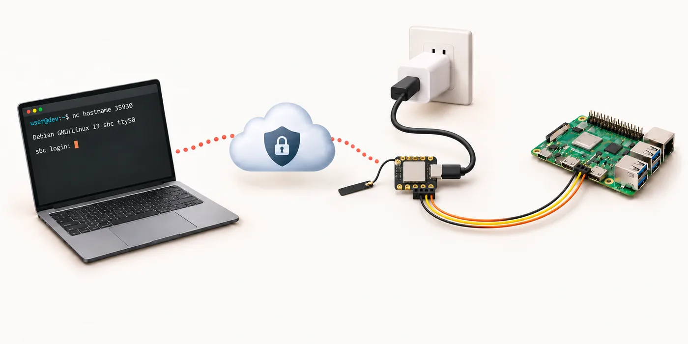

# serial-over-tailnet

[日本語](README-ja.md)

An ESP32-S3 board with PSRAM that joins a Tailscale network (a tailnet) on its own and bridges the serial console of a target SBC to a TCP port on the tailnet.
The console is a 3.3 V UART of the target (with a Seeed Studio XIAO ESP32S3 or ESP32C3) or one of its USB serial interfaces (with a YD-ESP32-S3).
The project was called usb-serial-over-tailscale until November 2026.



```text
Remote PC ──Tailscale / TCP:35930────▶ XIAO ESP32S3/C3 ──UART───▶ UART console of the target SBC
Remote PC ──Tailscale / TCP:35930+n──▶ YD-ESP32-S3 ───USB host──▶ serial interface n of the target SBC
```

Everything a Tailscale node needs (control protocol, WireGuard, DERP, NAT traversal) is implemented in Rust in this repository.
Initial setup is an interactive shell over USB serial; flashing and setup are done from a browser, with nothing to install.

## Status

Working end to end:

- Wi-Fi setup through the wizard and joining a tailnet with the approval URL.
- `tailscale ping` from another node, both via DERP and over a direct path.
- With a XIAO ESP32S3: the console of a Raspberry Pi 5 over its 3.3 V UART (the 3-pin debug connector).
- With a XIAO ESP32C3 (no PSRAM): joining a tailnet of 50 peers, its DERP connection, 300 bridge connections in a row with memory steady, its UART in a loopback (D10 wired to D8) over the tailnet, and the console of a NanoPC-T6 on its 3.3 V debug UART at 1500000 baud, the line set by pyserial's `rfc2217://`.
- With a YD-ESP32-S3: console access to a Raspberry Pi Debug Probe (CDC-ACM) and a Toradex Dahlia (FT4232H) over USB.
- RFC 2217 sessions against both USB targets: baud rate and framing changes, DTR and RTS, break and purge from pyserial.
- On the FT4232H, three ports claimed at once and a client on the fourth port refused.
- Recovery after adapter reboot, Wi-Fi reconnection and USB replug.

Not yet:

- Headless registration with an auth key.
- CP210x, CH340/CH341, and non-H-series FTDI chips such as the FT232R.
- Recovery after a reboot of the target SBC, an internet outage, or an unreachable control server.
- Long-running operation, behaviour after node key expiry (180 days by default), and reboots triggered by the task watchdog.
- esptool through RFC 2217 (its DTR and RTS sequence is tested on the host with `cargo run -p adapter-core --example rfc2217_sim`).

### Boards and images

Flash size and PSRAM mode are build-time settings, so CI builds one image per board and module (`firmware/variants/`).
PSRAM is required on the ESP32-S3 boards: network thread stacks, TLS buffers and most of the heap live there.
The ESP32-C3 has none; its image is built with smaller stacks and buffers (feature `small-ram` of tsnode), and about 40 KB of its RAM stays free on a tailnet of 50 peers.

| Image | Board | Flash | PSRAM | Status |
| --- | --- | --- | --- | --- |
| `xiao-s3` | Seeed Studio XIAO ESP32S3 | 8 MB | 8 MB octal | supported |
| `xiao-c3` | Seeed Studio XIAO ESP32C3 | 4 MB | none | supported (UART tried in a loopback) |
| `n16r8` | YD-ESP32-S3 with an N16R8 module | 16 MB | 8 MB octal | supported |
| `n8r2` | YD-ESP32-S3 with an N8R2 module | 8 MB | 2 MB quad | supported |
| `n8r8` | YD-ESP32-S3 with an N8R8 module | 8 MB | 8 MB octal | built |
| | modules without PSRAM (N4, N8, N16) | | none | not supported |

To build an image locally, point esp-idf-sys at its defaults file and pass its name to the image script.
The XIAO's image also needs its feature; the ESP32-C3 is another target and is built without the USB host component:

```bash
cd firmware
ESP_IDF_SDKCONFIG_DEFAULTS="sdkconfig.defaults;variants/xiao-s3.defaults" cargo build --release --features board-xiao-s3
tools/mkimage.sh xiao-s3 release

MCU=esp32c3 ESP_IDF_SYS_EXTRA_COMPONENTS_FILE="$PWD/variants/no-extra-components.toml" \
ESP_IDF_SDKCONFIG_DEFAULTS="sdkconfig.defaults;variants/xiao-c3.defaults" \
  cargo build --release --features board-xiao-c3 --target riscv32imc-esp-espidf
tools/mkimage.sh xiao-c3 release

ESP_IDF_SDKCONFIG_DEFAULTS="sdkconfig.defaults;variants/n8r2.defaults" cargo build --release
tools/mkimage.sh n8r2 release
```

## Layout

| Path | Role |
| --- | --- |
| `crates/tsnode` | Tailscale node: control plane (ts2021 Noise and a minimal HTTP/2), WireGuard, DERP, disco, STUN, TCP termination with smoltcp. Runs on a host and on ESP-IDF. |
| `crates/adapter-core` | Interactive setup shell. I/O and device operations are traits, so the wizard is unit-tested on the host. |
| `tools/hostnode` | Runs tsnode on Linux for verification: joins a real tailnet and serves an echo server. |
| `firmware` | ESP32-S3 and ESP32-C3 firmware (esp-idf-svc): setup console, UART bridge (XIAO ESP32S3 and ESP32C3), USB host (YD-ESP32-S3: CDC-ACM, FTDI, CP210x, CH34x), Wi-Fi, Tailscale node, TCP bridge. |
| `hardware/case` | 3D-printed case for the YD-ESP32-S3: OpenSCAD source and ready-to-print STLs, with and without pin headers ([README](hardware/case/README.md)). |
| `hardware/xiao-carrier` | Carrier board for the XIAO ESP32S3 with level translation and a 4-pin header; designed, not made ([README](hardware/xiao-carrier/README.md)). |
| `hardware/board` | Our own adapter board around the ESP32-S3-MINI-1; ordered, not yet verified ([README](hardware/board/README.md)). |

tsnode is split into these modules.

| Module | Contents |
| --- | --- |
| `controlbase`, `h2`, `control` | `/key` fetch, Noise IK handshake over `POST /ts2021`, `/machine/register` and `/machine/map` over HTTP/2. `/key` is always TLS; the Noise transport tries plain :80 first and falls back to TLS. |
| `wireguard` | Noise IKpsk2 handshake (initiator and responder), transport, replay window, rekey and keepalive timers. |
| `derp` | DERP relay client (TLS, fast-start, ping/pong, NotePreferred). |
| `disco`, `stun` | ping, pong and call-me-maybe for direct paths; public endpoint discovery with STUN. |
| `magicsock` | Path selection between UDP and DERP, handshake handling, peer table. |
| `netstack` | TCP termination on the tailnet addresses with smoltcp. |
| `node` | Ties the above together in threads. Keys persist in NVS or a file. |

## Usage

### Prepare the board

Two boards can be used; which one depends on where the target's console is.

| Board | Bridges | Soldering |
| --- | --- | --- |
| Seeed Studio XIAO ESP32S3 | a 3.3 V UART of the target (pins or a debug connector) | none on a board that comes with pin headers |
| Seeed Studio XIAO ESP32C3 | the same, on other pins | the same |
| YD-ESP32-S3 | a USB serial interface of the target (its debug USB port) | required (the `USB-OTG` pad on the back) |

#### Seeed Studio XIAO ESP32S3

Buy a [Seeed Studio XIAO ESP32S3](https://www.seeedstudio.com/XIAO-ESP32S3-p-5627.html).
It has one USB-C port and no USB host role here: it bridges a **3.3 V UART** instead of a USB serial adapter, on port 35930.
Use it when the target has a UART on pins or a debug connector, such as the 3-pin debug connector of a Raspberry Pi 5.

| XIAO pin | Role | Connect to |
| --- | --- | --- |
| `GND` | ground | the target's GND |
| `3V3` | not used | leave unconnected |
| `D10` | TX (out of the XIAO) | the target's RX |
| `D9` | RX (into the XIAO) | the target's TX |

The four pins are next to each other on one side of the board (from the USB-C end: 5V, GND, 3V3, D10, D9, D8, D7).
On a board that comes with pin headers, jumper wires plug straight onto them; on a bare board, solder a 4-pin socket or pin header there.
The UART is 3.3 V only: do not connect 5 V or RS-232 signals, and put a level translator in between for a 1.8 V target.
Attach the antenna that comes with the board.

On the installer page it is the first entry under "Choose your board".
If no serial port appears, hold the `B` (BOOT) button while plugging the board in.
The USB port stays the setup console after setup as well (there is no second port), and it powers the board: a charger or a USB port of the target will do.
The baud rate is set with `baud` (115200 by default) or by an RFC 2217 client; there are no DTR and RTS lines.

Verified with the plain XIAO ESP32S3 on a Raspberry Pi 5; the Sense and Plus versions have not been tried.
The firmware limits the Wi-Fi transmit power to 15 dBm on this board: at 19.5 dBm and above it did not get past association with two access points, and at 18 dBm and below it did.
In Japan the board is sold with 技適: construction design certification number 217-230892, as [Akizuki Denshi lists it](https://akizukidenshi.com/catalog/g/g118078/). Elsewhere, check the marking on the board and the rules that apply to you.
[`hardware/xiao-carrier/`](hardware/xiao-carrier/) is a small carrier board for it (not made yet).

#### Seeed Studio XIAO ESP32C3

The [XIAO ESP32C3](https://wiki.seeedstudio.com/XIAO_ESP32C3_Getting_Started/) has the same outline and is used the same way, with these differences:

| XIAO pin | Role | Connect to |
| --- | --- | --- |
| `GND` | ground | the target's GND |
| `D10` | TX (out of the XIAO) | the target's RX |
| `D9` | not used | leave unconnected |
| `D8` | RX (into the XIAO) | the target's TX |

The pins are on the same side as on the S3 (from the USB-C end: 5V, GND, 3V3, D10, D9, D8, D7); a 5-pin socket from GND to D8 covers them.
RX is on D8 instead of D9 because the C3's D9 is GPIO9: the BOOT button pulls it to ground, and the chip starts in download mode if it is low at reset.
The carrier board connects D9, so it does not fit the C3.

Its ESP32-C3 has no PSRAM, so the firmware keeps less: only a few endpoints per peer, a peer's WireGuard state only once the peer talks to it, and a TCP window of 2 KB on the tailnet.
It has joined a tailnet of 50 peers with about 40 KB of RAM to spare; a much larger tailnet may not fit.
Its UART has been tried in a loopback, not yet against a target.
In Japan the board is sold with 技適: construction design certification number 204-B00704, as [Akizuki Denshi lists it](https://akizukidenshi.com/catalog/g/g117454/).

#### YD-ESP32-S3


Buy the [**YD-ESP32-S3** from VCC-GND Studio (its page on AliExpress)](https://www.aliexpress.com/item/1005004025123046.html).
On that page choose **N16R8** or **N8R2**: those two are supported.
The board has two USB-C ports, labelled `COM` and `USB` ([photos and documents from its maker](https://github.com/vcc-gnd/YD-ESP32-S3)).

**A note on radio certification.** The YD-ESP32-S3 is a good, inexpensive board. One thing to know before buying: its Wi-Fi module (marked `ESP32-S3-N16R8` or `ESP32-S3-N8R2`) is not one of Espressif's certified modules. It has no Japanese 技適 (we looked it up in the MIC database), and we have not found a radio certification for it in any other country either. Whether that matters depends on where you are: many countries put the obligation on sellers rather than on hobbyists, so please check the rules that apply to you. In Japan, the Radio Act asks the user's own equipment to carry the 技適 mark, so this board cannot be used there; for Japan we are making a board around the certified ESP32-S3-MINI-1 module, see [`hardware/board/`](hardware/board/) (designed and ordered in November 2026, not yet verified).

Short the `USB-OTG` solder pad on the back of the board (shown below before bridging).


This is required: it feeds 5 V from the board to the target's USB port, and without it the target chip never powers up and is never detected.
The two ports have fixed roles: **`COM` = 5 V power in** (a charger or a PC), **`USB` = the SBC** (the target's debug USB port). For flashing and setup, `COM` goes to the PC (it powers the board as well); `USB` can stay on the SBC.
See "Power and wiring" below for the safety rule that follows from it.

### Flash from a browser

Open [signal-slot.github.io/serial-over-tailnet](https://signal-slot.github.io/serial-over-tailnet/) in Chrome or Edge to flash and configure the board without installing anything.
The page opens the board's serial port with WebSerial and writes the CI-built binaries with ESP Web Tools (esptool-js).
A terminal on the same page runs the setup wizard.
It works on Windows 10 and later, macOS, Linux and ChromeOS; it does not work in Firefox, Safari or on phones.

Choose the board at the top of the page.

- **XIAO ESP32S3**: connect its USB-C port to the PC. It shows up as `USB JTAG/serial debug unit` (303a:1001). If no port appears, unplug it, hold the `B` (BOOT) button and plug it in again.
- **YD-ESP32-S3**: choose the module from the marking on its metal can (for example `ESP32-S3-N16R8`) and connect the `COM` port (CH343, 1a86:55d3). It flashes through the board's auto-download circuit, carries the boot log, and the target can stay plugged into the native port. The native port (303a:1001) works too and starts the wizard as soon as a terminal opens, but it disappears when setup completes and the port becomes the USB host; use it if the operating system does not list the COM port.

CI (GitHub Actions) builds every image on each push. Tags matching `v*` also attach `serial-over-tailnet-<image>.bin` (bootloader, partition table and app merged into one file) to a release.
The merged file can be written with `esptool write_flash 0x0`, but it also overwrites the NVS area with 0xFF, which erases the configuration and registration.
Updates from the page write only the three regions and keep the configuration.

### Initial setup

An unconfigured board plugged into a PC shows up as a USB serial port (Espressif USB JTAG/serial, 303a:1001): the XIAO's only port, the YD-ESP32-S3's native port.
Open it in a terminal and press Enter to start the wizard.
On the XIAO this port stays the shell after setup too, quiet until a command is typed.
On the YD-ESP32-S3 the COM port carries the same shell at 115200 together with the log output; it stays quiet until Enter, and `setup` starts the wizard there.

```bash
screen /dev/ttyACM0 115200
```

Leave DTR and RTS as a terminal leaves them, both asserted.
On these ports they reset the chip and select its boot mode, so a tool that
drives them apart resets the board, possibly into the ROM download mode, where
it goes quiet and answers nothing.

```text
serial-over-tailnet 0.1.0 - setup mode
Press Enter to start setup, or type a command:
=== Setup ===
Scanning Wi-Fi...
   1) home-wifi        (-48 dBm)
Select network number, or type an SSID (Enter to rescan, q to quit): 1
Password for home-wifi: ********
Connected (192.168.1.42)
Hostname on the tailnet [target-console]:
Registering with Tailscale... (press q to stop waiting)
Open this URL in a browser to approve the device:
  https://login.tailscale.com/a/xxxxxxxx
Waiting for approval...
Tailscale is up: target-console.example.ts.net 100.x.y.z
Setup complete. Reboot into normal mode now? [Y/n]
```

`setup` only adds a Wi-Fi network when the hostname and the Tailscale registration are already done.
`setup all` starts over.
To use an auth key, run `authkey tskey-auth-...` and then `login`.

The main commands are listed below; `help` prints the full list.

| Command | Description |
| --- | --- |
| `wifi <ssid> <pw>` | Add a Wi-Fi network and connect. Several can be stored; the strongest known AP is chosen at boot and on reconnect. |
| `wifi list`, `wifi forget <ssid>` | List and remove stored networks. |
| `port <n>`, `baud <rate>` | TCP port (default 35930; on the YD-ESP32-S3, USB interface n of the target is served on port+n) and baud rate of the target (default 115200). |
| `usbdrv <auto\|cdc\|ftdi\|cp210x\|ch34x>` | YD-ESP32-S3 only: USB-serial bridge chip. The default detects it from VID and PID. |
| `status`, `reset`, `reboot` | Show status, erase configuration and keys, reboot. |

On the XIAO the shell is always on the USB port, so any command, `setup` included, can be run at any time; the log goes to UART0 on pins D6 (TX) and D7 (RX) at 115200 bps.
On the YD-ESP32-S3 the same shell is always available on the COM port (115200 bps, shared with the log): press Enter to get a prompt.
Holding BOOT while the firmware starts enters setup mode again.

### Connecting

The XIAO ESP32S3 serves its UART on one TCP port: 35930, unless `port` changed it.

With a YD-ESP32-S3, every serial interface of the target is served on its own TCP port: the first port plus the USB interface number.
Which interfaces those are is read from the device when it is plugged in, so nothing has to be configured.

| Target | Interface | Port |
| --- | --- | --- |
| A plain CDC-ACM console (one function) | 0 | 35930 |
| Raspberry Pi Debug Probe (interface 0 is CMSIS-DAP) | 1 | 35931 |
| Toradex Dahlia, MCU console (FT4232H port C) | 2 | 35932 |
| Toradex Dahlia, Verdin console (FT4232H port D) | 3 | 35933 |

From any machine on the tailnet, open a raw TCP connection to that port of the hostname or tailnet address, or an RFC 2217 (Telnet) one.

```bash
socat -,rawer,escape=0x1d TCP:target-console:35930   # Ctrl-] to exit
nc target-console 35930
python -m serial.tools.miniterm rfc2217://target-console:35930 9600   # RFC 2217: the client sets the line
esptool --port rfc2217://target-console:35930 flash_id                 # YD-ESP32-S3: DTR and RTS reset an ESP32 target
```

One connection at a time is served per port.
A second connection while one is active receives `busy` and is closed.
A peer that stops responding is dropped after 120 seconds and the next connection is accepted.

The first byte the client sends decides what the session is.
A client that opens with Telnet negotiation (IAC, 0xFF), as pyserial's `rfc2217://` and esptool do, gets an RFC 2217 session: it can set the baud rate, data bits, parity and stop bits, drive DTR and RTS, hold a break and purge the receive buffer, and every setting is answered with the value in force, so a refused one is visible to the client.
The settings last until the client disconnects; the next session starts again from the adapter's `baud` and 8N1 with DTR and RTS asserted.
Flow control is reported as none, and modem-state and line-state notifications are not sent.
Anything else is a raw session: bytes flow unchanged in both directions, there is no protocol on top, and the baud rate is the adapter's setting.
A `telnet` client that negotiates first (netkit, inetutils) gets an RFC 2217 session in character mode; the BSD one waits for the server to speak first and so gets a raw session in line mode.
Bytes the target sends before the client's first byte go out unframed in either case.
On the XIAO's UART there are no DTR and RTS lines (requests are accepted and do nothing), a break is made by holding TX low, and mark and space parity are refused.

With a YD-ESP32-S3 the ports are independent: each has its own USB interface, its own busy state and its own line settings, and a client on one port does not block another.
They share one USB device and one tailnet address.
The USB interface is claimed when the first client connects to its port and stays claimed after the client leaves; output from the target is dropped while nobody is connected.
The ESP32-S3's host controller has eight pipes, one for control and two per claimed interface (three for CDC-ACM), so at most three ports of an FT4232H can be claimed, and the claims last until the device is unplugged or the adapter reboots. A client on a fourth port is told `usb: cannot open the interface: no free USB host pipe` and closed.
`status` on the shell lists the interfaces with their ports, marks the open ones with their line settings and the idle claimed ones with `claimed`.

### Power and wiring

**XIAO ESP32S3.**
Power it through its USB-C port: a charger, a PC, or a USB port of the target.
Powered from the target, it goes down when the target's USB power does and needs some tens of seconds after power-up to join the tailnet; from a charger it stays reachable while the target reboots.
The target is connected with three wires, as in the table under "Prepare the board"; the XIAO's `3V3` pin stays unconnected.

**YD-ESP32-S3.**
Power the board through the COM-side USB port, from a PC or a USB charger.
The native port is the USB host port for the target; the target's debug port is not expected to supply power.

To supply 5 V from the native port, bridge the `USB-OTG` solder pad on the back of the board.
The pad bypasses the diode between the board's 5 V and the native port, so the 5 V of the COM side comes out of the native port (one diode drop lower). After bridging it **never plug both ports into PCs at the same time**: the COM side would feed the PC on the native port.
For flashing and setup, connect the COM port to the PC; if you use the native port for that instead, connect only that one.
In normal operation, connect the COM port to power and the native port to the target.
If the target is a CDC-ACM or FTDI-style bridge chip, that chip is usually bus-powered and needs this 5 V.

### A board that resets every few seconds

If the board keeps restarting (on the YD-ESP32-S3 the COM port log shows a new `ESP-ROM` banner every 1 to 4 seconds with `rst:0x3 (RTC_SW_SYS_RST)`), read `Reset:` in `status`, or the line `last reset:` near the top of the next boot's log.
`brownout` means the supply voltage dropped while Wi-Fi was transmitting or the target's bridge chip was starting.
The fix is the power: a port or charger that can supply the board and the target's bridge chip together, with a short cable.
The IDF's own "Brownout detector was triggered" line can be missing from the log, and the ROM banner looks the same as after `reboot`.
The `Password length is zero` warning in older firmware came from a placeholder configuration on every boot and did not mean the stored password was empty; `wifi list` shows whether each network has one.
`RECOVERY.md` has the procedure as it was done for one board.

## Building and flashing

Prerequisites are the `esp` toolchain installed with `espup`, `ldproxy` and `espflash`.
ESP-IDF v5.5.5 and the `espressif/usb_host_cdc_acm` component are fetched into `firmware/.embuild/` on the first build (several GB, several minutes).

```bash
# host-side unit tests and verification tool
cargo test
cargo run -p hostnode -- probe-control                      # control-plane check (an AuthURL from a keyless registration is enough)
cargo run -p hostnode -- run --hostname tsnode-test        # join a real tailnet and serve an echo server (prints the approval URL)

# firmware (the n16r8 image; see "Boards and images" for the others)
cd firmware
cargo build --release
```

Do not source `~/export-esp.sh`.
gcc and clang come from what esp-idf-sys installs into `.embuild/`; with espup's Xtensa gcc first on PATH the link fails.

The partition table is `firmware/partitions.csv` (6 MB factory app).
To flash, build the binaries into `dist/<image>/` with `tools/mkimage.sh <image> release` and write them with esptool.

```bash
cd firmware && tools/mkimage.sh xiao-s3 release
PY=$(ls -d .embuild/espressif/python_env/*/bin/python | head -1)
$PY -m esptool --chip esp32s3 --port /dev/ttyACM0 --baud 921600 write_flash \
  0x0 dist/xiao-s3/bootloader.bin 0x8000 dist/xiao-s3/partition-table.bin 0x10000 dist/xiao-s3/app.bin
```

`/dev/ttyACM0` is the board's port on Linux; use the one your machine gives it.
Flash with esptool as above: `espflash` does not accept this firmware's image.
`hostnode run` stores its keys in plain text in `hostnode-state.json`.

## Design decisions

- Capability version 106; map responses are received uncompressed. Headscale is not supported.
- Authentication defaults to the approval URL; an auth key is optional and is removed from NVS once registration succeeds.
- Tailscale ACLs (PacketFilter) are enforced on the receiving side. Every packet is dropped until the filter arrives.
- The home DERP region is chosen at boot by STUN round-trip time to each region, falling back to `tok` and then to the lowest region ID.
- Direct paths are established with disco ping/pong and call-me-maybe. The source of an authenticated UDP packet from a peer is also adopted as a path.
- WireGuard timestamps are corrected with the offset between the system clock and control time, and with SNTP.
- Network thread stacks live in PSRAM; only the control thread, which writes flash, keeps an internal-RAM stack.
- The network map is parsed while it arrives and never held as text: keys and addresses become binary as they are read, fields that are not used are skipped, each peer is a separate allocation, and a peer's WireGuard state is made the first time the peer talks to us. The first map of a tailnet of 49 peers is 69 KB of JSON; held whole and as text it did not fit an ESP32-C3.
- A bridge keeps one serial-to-TCP thread for all its sessions. Every Rust thread that ends on ESP-IDF leaves about 160 bytes behind (plain pthreads do not), so a thread per session ran an ESP32-C3 out of memory after some 150 connections. The session is handed to that thread in a slot it checks every 20 ms, and its end is a flag the session checks: handing it over through a channel, each thread parked until the other woke it, corrupted a thread's stack on the ESP32-S3 about once in 300 sessions.
- The heap prefers PSRAM, and Rust code is built without the hardware compare-and-swap instruction (`target-feature=-s32c1i`): on the ESP32-S3 that instruction is not atomic between the two cores for a word in PSRAM, which broke `Mutex` and `Arc`. Atomics go through ESP-IDF's `__atomic_*` functions instead.
- The USB host relies on the CDC-ACM host driver's fallback of opening any interface with two bulk endpoints; FTDI, CP210x and CH34x get only their chip-specific setup through vendor control transfers.
- The interface stays claimed between sessions because of the USB data toggle. A pipe the host creates starts at DATA0, while the device keeps the toggle of each endpoint from the session before. Claiming the interface per session made the device acknowledge and drop the first packet of every other session, with no error on the host: the first keystroke vanished. Asking the device to reset its toggles with CLEAR_FEATURE(ENDPOINT_HALT) was tried and does not work on the Debug Probe (TinyUSB), so the pipes are kept instead.
- A claim is not released while the device is attached, so a fourth port cannot take the pipes of an idle one. Closing an interface of a device that keeps answering IN polls (an FTDI chip does, every 2 ms) races with the CDC driver's task: the driver halts and clears the pipe and releases the interface while its task resubmits the poll, and the release or the host controller's interrupt handler aborts the firmware about one close in ten. Retrying the release and halting the pipes again from the closing thread (through a linker `--wrap`) and ESP-IDF v5.3.5 (espressif/esp-idf#17707) were tried and still crashed.
- A break on a Linux console, or bytes sent at a lower baud rate than the console's, is a BREAK to the target: `agetty` then cycles through its baud rates, and the kernel's SysRq takes the next byte as a command, which can reboot the target. Test line settings against a console that has nothing to lose.

## Out of scope

Secure Boot and flash encryption, OTA, a web management UI, multiple simultaneous connections and USB hubs.

## License

MIT.
The Tailscale and WireGuard protocol code was written from the protocol descriptions and the Tailscale (BSD-3-Clause) and wireguard-go (MIT) sources.
The USB-serial baud-rate encodings were written from FTDI's application note AN232B-05, Silicon Labs' AN571, Espressif's esp-usb VCP drivers (Apache-2.0) and FreeBSD's `uftdi` and `uchcom` drivers (BSD-2-Clause).
